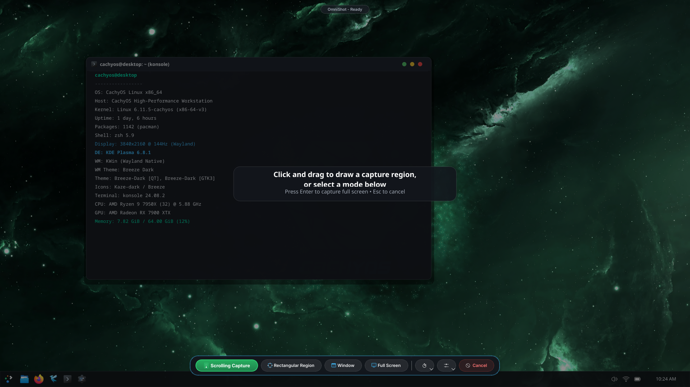
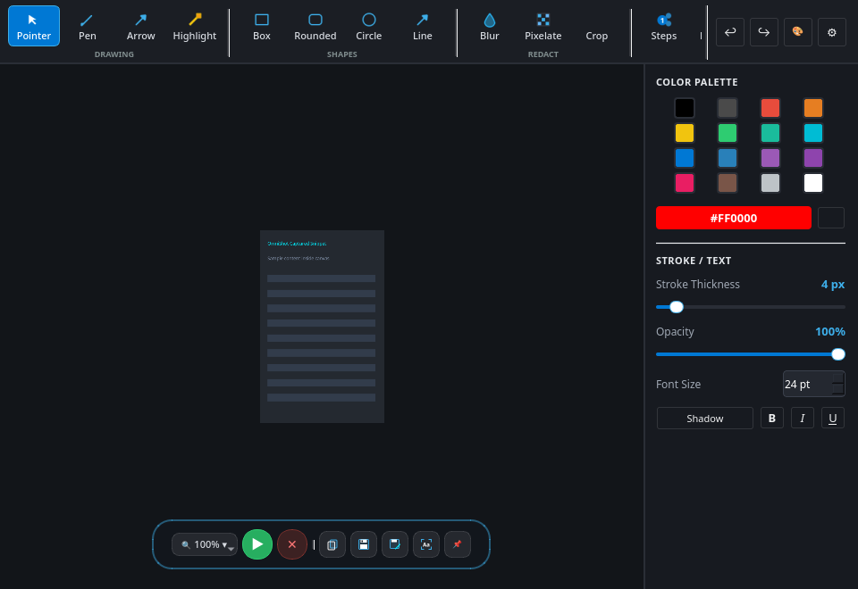
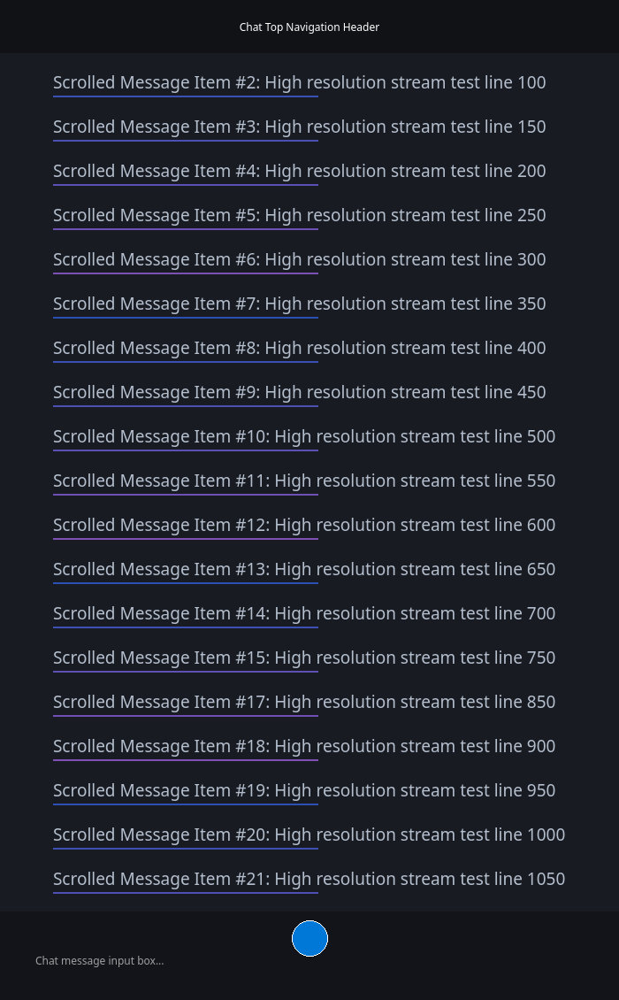

<div align="center">
  
  <h1>OmniShot</h1>
  <p><strong>The Next-Generation Screenshot & Scrolling Capture Suite for KDE Plasma 6 (Wayland)</strong></p>
  <p><em>Created by HearneLabs, inspired by Spectacle/ShareX, fuelled by caffeine ☕</em></p>

  <p>
    <a href="https://github.com/hearnelabs/OmniShot/blob/master/LICENSE"></a>
    
    
    
    
  </p>
</div>

---

## 🌟 Overview

**OmniShot** is an ultra-fast, professional screenshot and continuous scrolling capture application engineered specifically for **CachyOS**, **Arch Linux**, and **KDE Plasma 6 (KWin Wayland)**.

It delivers the one killer feature that Linux desktop screenshot utilities have always lacked: **Pixel-Perfect Continuous Scrolling Capture**, combined with an extensive Spectacle & ShareX-grade vector annotation editor, single-click OCR text extraction, and seamless Wayland desktop integration.

---

## 📸 Screenshots

### 1. In-Situ Floating Launch Bar
*Minimalist floating capsule overlay with quick snip triggers, delay countdown, and direct scrolling capture prompt:*

<div align="center">
  
</div>

### 2. Annotation & Image Editor
*Full-featured vector annotation suite with categorized tool ribbon, color swatches, adjustable opacity/stroke sliders, and pinned utility controls:*

<div align="center">
  
</div>

### 3. Real-Time Scrolling Capture HUD
*Floating Wayland HUD with live height counter, frame tracker, and real-time expanding miniature thumbnail:*

<div align="center">
  
</div>

---

## ✨ Features

- 📜 **Continuous Scrolling Capture (Auto & Manual)**:
  - Capture entire web pages, long terminal outputs, chat conversations, code buffers, and PDF documents.
  - Sub-millisecond C/AVX2 multi-strip correlation engine stitches slices seamlessly without vertical artifacts or seam lines.
  - Floating status HUD with live pulsing recording indicator and dynamic expanding thumbnail preview.
  - Automatic end-of-scroll detection when the page hits bottom.
- 🖥️ **Direct KWin Wayland Backend**:
  - Leverages `org.kde.KWin.ScreenShot2` pipe-based screencopy for zero-latency, high-speed captures.
  - Preserves 1:1 hardware pixel resolution across High-DPI screens and fractional scaling (1.25x, 1.5x, 2.0x).
- 🎮 **Hardware-Level Virtual Input (`/dev/uinput`)**:
  - Injects synthetic mouse wheel and keyboard scroll events directly through the Linux input subsystem.
  - Unprivileged access via systemd `uaccess` rules—no root/sudo password prompts during everyday usage.
  - Graceful fallback to interactive manual scroll mode if virtual input is unavailable.
- 🎨 **Spectacle & ShareX-Grade Annotation Suite**:
  - **Drawing**: Freehand Pen & Translucent Highlighter (single-pass scratch buffer compositing preserves 100% text readability).
  - **Geometric Shapes**: Rectangles, Rounded Rectangles, Ellipses, Straight Lines, and Directional Arrows.
  - **Privacy Redaction**: Gaussian Blur and Checkered Pixelation Mosaic filters.
  - **Sequential Badges**: Auto-incrementing step bubbles (`①`, `②`, `③`...) and Speech Balloons.
  - **Typography**: Draggable rich text annotations with font sizing, drop shadow, bold, italic, and underline.
  - **Canvas Tools**: Interactive cropping tool and full Undo (`Ctrl+Z`) / Redo (`Ctrl+Y`) history.
- 🔍 **Integrated Tesseract OCR**:
  - One-click optical character recognition instantly extracts text from any selection or scrolling document directly into your clipboard.
- 📐 **Fully Resizable & Responsive Layout**:
  - Window resizes cleanly down to compact viewports ($480 \times 360$) and up to multi-monitor 4K displays.
  - Top header features a flexible scrollable tool ribbon on the left with pinned utility controls (`Undo`, `Redo`, `Palette Toggle`, `Settings`) anchored on the top-right.
  - Floating bottom action capsule automatically centers in the viewport and anchors cleanly above the bottom edge.
- ⚙️ **Settings & KDE Hotkey Integration**:
  - Easily customize default save directory, filename templates (`OmniShot_%Y%m%d_%H%M%S.png`), scroll step increments, and auto-copy preferences.
  - Configures global Plasma 6 shortcuts (`Meta+Shift+S`, `Meta+Shift+R`, `Print`) out-of-the-box.

---

## 🚀 Installation on CachyOS / Arch Linux

### Method 1: Automated 1-Step Installer (Recommended)

Clone the repository and run the automated installer:

```bash
git clone https://github.com/hearnelabs/OmniShot.git
cd OmniShot
./install.sh
```

**What the installer does automatically:**
1. Checks and verifies standard package dependencies (`pyside6`, `python-dbus`, `kconfig`, `kservice`, `libnotify`, `tesseract`, `tesseract-data-eng`, `gcc`).
2. Compiles the high-performance native C stitching engine (`libomnishot_stitch.so`) with `-O3 -march=native`.
3. Verifies `/dev/uinput` permissions and installs the udev rule (`99-omnishot-uinput.rules`) if required.
4. Generates pixel-perfect icons across all hicolor resolutions (`16x16` up to `512x512` and scalable vector SVG) and updates your active icon theme (`Kaze-dark`, `Breeze-Dark`, etc.).
5. Installs the desktop launcher to `~/.local/share/applications/omnishot.desktop` and creates a symlink in `~/.local/bin/omnishot`.
6. Registers KDE Plasma 6 global shortcuts (`Meta+Shift+S`, `Print`) and refreshes desktop icon and sycoca caches.
7. Executes the automated test suite to verify system integrity.

---

### Method 2: Arch / CachyOS PKGBUILD (`makepkg`)

OmniShot includes a standard `PKGBUILD` for Arch package managers:

```bash
git clone https://github.com/hearnelabs/OmniShot.git
cd OmniShot
makepkg -si
```

---

## ⌨️ Usage & CLI Shortcuts

Launch OmniShot from your application menu (Kickoff), KRunner (`Alt+Space`), or the terminal:

```bash
# Launch the main OmniShot annotator window
omnishot

# Start an Auto-Scrolling Capture session immediately
omnishot -S

# Start an Interactive Manual Scrolling Capture session
omnishot -M

# Snip a rectangular screen region (Spectacle default)
omnishot -r

# Capture the active window
omnishot -a

# Capture the entire desktop workspace
omnishot -f

# Open an existing image in the annotator
omnishot -E ~/Pictures/Screenshots/capture.png
```

### Global Keyboard Shortcuts

| Shortcut | Action |
| :--- | :--- |
| `Meta + Shift + S` / `Print` | Open In-Situ Snip / Scrolling Overlay |
| `Meta + Shift + R` | Start Scrolling Capture immediately |
| `Shift + Print` | Capture Entire Desktop |
| `Meta + Print` | Capture Active Window |

### Editor Shortcuts

| Shortcut | Action |
| :--- | :--- |
| `Ctrl + C` | Copy composite image to clipboard |
| `Ctrl + S` | Quick save to configured screenshots directory |
| `Ctrl + Shift + S` | Save As... (choose file format and destination) |
| `Ctrl + Z` / `Ctrl + Y` | Undo / Redo annotation |
| `Ctrl + +` / `Ctrl + -` | Zoom in / Zoom out |
| `Ctrl + 0` | Fit image to window |
| `Ctrl + 1` | Zoom to 100% (1:1 native hardware pixels) |
| `Ctrl + ,` | Open Settings & Hotkey Configuration dialog |
| `Enter` | Confirm selection / Finish scrolling session |
| `Esc` | Cancel capture / Discard editor changes |

---

## ⚙️ Configuration

Settings can be customized graphically via the built-in **Settings Dialog** (`Ctrl+,` or ⚙ icon) or directly edited in `~/.config/omnishot/config.json`:

```json
{
  "save_directory": "~/Pictures/Screenshots",
  "filename_template": "OmniShot_%Y%m%d_%H%M%S.png",
  "default_format": "png",
  "copy_to_clipboard_on_save": true,
  "scroll_step_pixels": 120,
  "scroll_delay_ms": 150,
  "scroll_max_frames": 100,
  "scrollbar_margin_right": 24,
  "scroll_similarity_threshold": 28.0,
  "auto_detect_end_of_scroll": true,
  "shortcut_launch": "Meta+Shift+S",
  "shortcut_scrolling": "Meta+Shift+R"
}
```

---

## 🏗️ Architecture

```
OmniShot/
├── bin/
│   └── omnishot             # PATH executable launcher
├── native/
│   ├── stitcher.c           # SIMD/AVX2 multi-strip correlation & translation detector
│   └── Makefile             # Native build script
├── omnishot/
│   ├── core/
│   │   ├── capture.py       # org.kde.KWin.ScreenShot2 Wayland screencopy
│   │   ├── uinput_mouse.py  # /dev/uinput virtual wheel and keyboard scroller
│   │   ├── stitcher.py      # Python controller with on-the-fly C auto-compiler
│   │   ├── stitcher.c       # Bundled source fallback for native C engine
│   │   ├── ocr.py           # Tesseract OCR text extractor
│   │   └── config.py        # Settings management & KDE shortcut persistence
│   ├── ui/
│   │   ├── launch_overlay.py# In-situ Spectacle-style floating launch bar & snip selector
│   │   ├── main_window.py   # Resizable annotation editor with pinned utilities
│   │   ├── canvas.py        # Vector annotation canvas with single-pass scratch highlighter
│   │   ├── scroll_hud.py    # Wayland floating HUD with live expanding thumbnail
│   │   ├── settings_dialog.py # Settings, default directory, and hotkey preferences
│   │   ├── icons.py         # High-contrast vector icon factory
│   │   └── theme.py         # KDE Plasma 6 Breeze Dark styling
│   ├── cli.py               # CLI argument parser
│   └── app.py               # Application lifecycle & session manager
├── tests/
│   └── test_omnishot.py     # Automated unit test suite (11/11 passing)
├── install.sh               # One-step automated installer for CachyOS / Arch
├── PKGBUILD                 # Arch Linux / CachyOS package build recipe
├── omnishot.desktop         # KDE desktop entry with actions and shortcuts
├── omnishot.svg             # Full-bleed Breeze 6 vector application icon
├── LICENSE                  # GNU General Public License v3.0
└── README.md
```

---

## 🧪 Testing

To run the automated verification suite:

```bash
python3 -m unittest discover tests -v
```

All 11 unit tests validate:
- Native C stitcher exact pixel displacement and margin detection
- `/dev/uinput` virtual device initialization and event emission
- KWin ScreenShot2 native Wayland screencopy
- Tesseract OCR engine availability
- Vector annotation hit-testing, rendering, and canvas cropping
- Translucent highlighter readability across light and dark backgrounds
- Opacity slider and color palette bidirectional synchronization
- Viewport and window resizability from $480 \times 360$ to $1600 \times 900$

---

## 📜 License & Credits

- **Created by**: [HearneLabs](https://github.com/hearnelabs)
- **Inspiration**: [KDE Spectacle](https://apps.kde.org/spectacle/) & [ShareX](https://getsharex.com/)
- **Fuel**: Caffeine ☕
- **License**: [GNU General Public License v3.0](LICENSE)

*Built with passion for CachyOS, KDE Plasma 6, and the Linux desktop community.*
